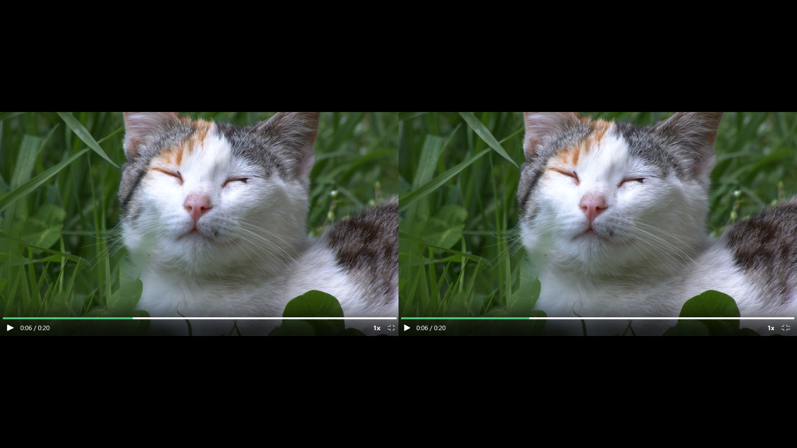
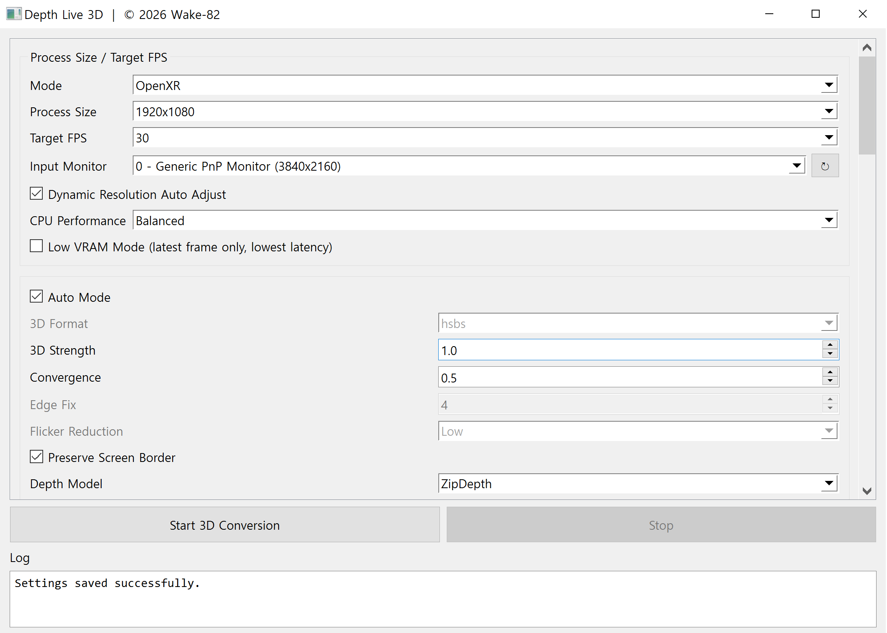
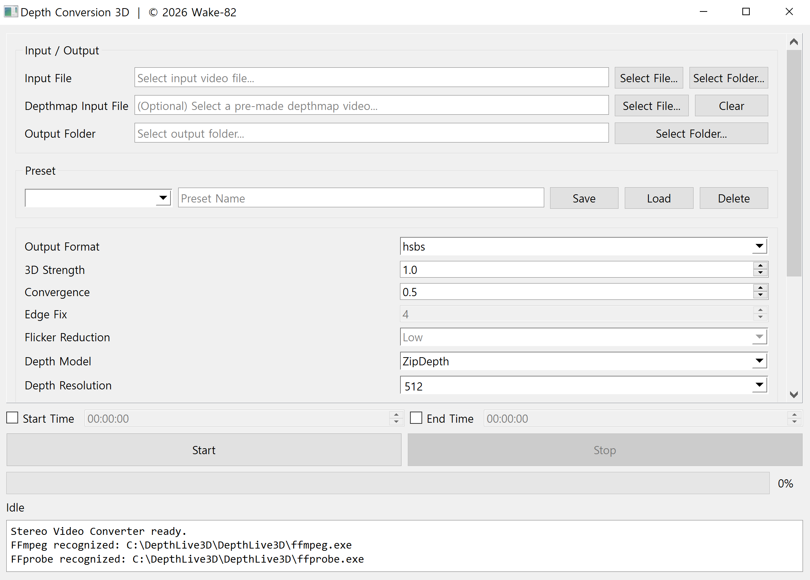

# DepthLive3D 

 
[README_EN](https://github.com/wake-82/DepthLive3D/blob/main/README.md)

## DepthLive3D란?

DepthLive3D는 AI 기반 뎁스맵과 OpenXR 기술을 사용하여 PC 화면을 VR 환경에서 실시간으로 3D로 변환해 주는 무료 프로그램입니다. 2D 영상 파일을 3D로 변환하는 오프라인 변환 기능도 함께 제공합니다.

## 3D 변환 샘플 영상

[Big Buck Bunny](https://youtu.be/GoZfcv_eMXA)
- 2D 원본 720p, VDA-S Stream, Depth Resolution 630, 3D Strength 2.0, Convergence 0.5, Auto Mode, Fast Inpaint

[Camel Demo](https://youtu.be/2lOhxtOKalw?si=cLFCvIuXstRVbHc9)
- VDA-S, Depth Resolution 630, 3D Strength 3.0, Convergence 0.5, Edge Fix 1, Flicker Reduction OFF, Depth AA OFF, Depth Linear Compression ON, Medium Inpaint (Conversion 3D 전용)

## 업데이트
**버전 3.3 업데이트 노트** 

**■ 일반**

* TensorRT 지원 구현 및 통합 ※ 참고: VDA 모델은 torch.compile과 TensorRT 모두 활성화해야 최대 변환 속도로 작동합니다. 
* Depth Anything V2 Small 모델 추가
* 인페인트 해상도 조절 옵션 추가
* 프리셋 설정 범위 업데이트
* VDA-S (Metric)의 절대 뎁스 값을 디스패리티 값으로 변환하도록 변경

**■ 런처**

* 콘솔 창 ON/OFF 토글 버튼 추가
* TensorRT 캐시 파일 삭제 버튼 추가

**■ Conversion 3D**

* 변환 완료 후 PC 종료 예약 옵션 추가
* 설정 초기화 버튼 추가

**■ Live 3D**

* 프리셋 및 뎁스맵 미리보기 기능 추가
* OpenXR 모드에서 Windows 터치 키보드를 실행하는 단축 동작 추가: VR 컨트롤러의 트리거와 A(또는 X) 버튼을 함께 2초간 누르기
* 레터박스 제거 토글 후 torch.compile 또는 TensorRT가 다시 빌드되는 동안 남은 시간 표시 추가
* 듀얼 모니터 3D 출력 모드 개선: Dynamic Resolution Auto Adjust를 켜면 두 모니터 모두 출력 해상도로 자동 전환
* OpenXR 모드에서 색상 보정이 제대로 작동하지 않던 문제 수정
* OpenXR 모드 진입 전에 torch.compile과 TensorRT를 미리 초기화하여 검은 화면이 나타나던 문제 수정

## 요구 사항

- **OS:** Windows 10/11 (64비트)
- **GPU:** CUDA를 지원하는 NVIDIA GPU
  - GTX 10xx 시리즈(Pascal) ~ RTX 40xx 시리즈 → CUDA 12.6
  - RTX 50xx 시리즈(Blackwell) 이상 → CUDA 12.8
  - 설치 프로그램이 GPU를 자동으로 감지하므로 CUDA 버전을 직접 선택할 필요가 없습니다.
- **NVIDIA 드라이버:** 최신 드라이버 권장 (CUDA 12.6 / 12.8 지원에 필요)
- **Python:** 3.12
- **Git:** 최신 버전 
- **디스크 공간:** 약 10GB 이상의 여유 공간 (PyTorch, 모델, 의존성 설치용)
- **VR 헤드셋(선택):** VR 출력을 사용할 경우 OpenXR 호환 헤드셋
  
---
## DepthLive3D Windows 10 & 11 빠른 설치 가이드

1. 먼저 Microsoft Visual C++ Redistributable x64 패키지(vc_redist.x64.exe)를 설치합니다:
https://learn.microsoft.com/en-us/cpp/windows/latest-supported-vc-redist?view=msvc-170

2. Releases 페이지에서 DepthLive3D 설치 파일을 다운로드하여 C:\DepthLive3D에 압축을 풉니다.
https://github.com/wake-82/DepthLive3D/releases/tag/VR

3. `enable_long_path.reg` 레지스트리 파일을 적용한 뒤 컴퓨터를 재시작합니다.
   torch.compile과 TensorRT를 활성화하고 안정적으로 사용하려면 Windows의 긴 경로 지원이 필요합니다.
https://learn.microsoft.com/en-us/windows/win32/fileio/maximum-file-path-limitation?tabs=registry

5. `DepthLive3D-Install.bat`을 실행합니다.

6. 설치가 완료되면 `Run.bat` 파일을 실행합니다.

7. 영상 파일을 변환하려면 Converted 3D를, 컴퓨터 화면을 실시간으로 3D로 변환하려면 Live 3D를 선택합니다.

※ 참고
1. 텐서RT 또는 torch.compile이 설치에 실패했거나 비활성화된 경우
install_tensorrt.bat 또는 install_torch_compile.bat을 실행하여 재설치를 시도해 보세요.
(단, 텐서RT는 GTX 10 시리즈 그래픽카드에서 지원되지 않으므로, 해당 제품군에서 활성화되지 않는 것은 정상적인 동작입니다.)

2. torch.compile 또는 TensorRT를 켜면 시작을 눌러도 변환이 바로 시작되지 않을 수 있습니다.
사용 중인 모델과 입력 크기에 맞는 최적화 캐시 파일을 생성하는 중이며, 몇 초에서 몇 분까지 걸릴 수 있습니다. 생성이 완료되면 변환이 자동으로 시작됩니다.
프로그램이 중단되었거나 응답하지 않는 것이 아니니, 완료될 때까지 기다려 주세요.
생성된 캐시는 이후 재사용되어 다음 실행부터는 훨씬 빠르게 시작됩니다. (입력 크기가 바뀌면 새 캐시가 생성됩니다. 예: 레터박스 제거를 켜고 끌 때)

---

## Live 3D 옵션

- **Mode** — OpenXR, PC, 듀얼 모니터 3D 출력 모드 중에서 선택합니다.  VR 기기에는 OpenXR을, 3D TV, AR 글래스, 일반 모니터에는 PC 또는 듀얼 모니터 3D 출력을 선택하세요.  듀얼 모니터 3D 출력 모드에는 외부 모니터 또는 가상 모니터가 필요합니다.
- **Process Size** — 캡처 해상도를 설정합니다. 720p 또는 1080p를 권장합니다.
- **Target FPS** — 캡처 프레임 레이트를 설정합니다. 30과 60 중에서 선택할 수 있습니다. 프레임 레이트가 불안정하면 30으로 바꿔 보세요.
- **Input Monitor** — 캡처할 모니터를 선택합니다. 주 모니터는 `0`으로 설정합니다.
- **Output Monitor** — 듀얼 모니터 3D 출력 모드에서 활성화됩니다.  Input Monitor에서 캡처할 모니터를, Output Monitor에서 3D 변환 결과를 표시할 모니터를 선택하세요.
- **Dynamic Resolution Auto Adjust** — Process Size 설정을 기준으로 해상도를 동적으로 자동 조절합니다. 켜면 리사이즈 과정을 생략하여 프레임 레이트가 향상됩니다.
- **CPU Performance** — 사용할 CPU 코어 수를 선택합니다. "High"로 설정한다고 해서 항상 성능이 좋아지는 것은 아니므로, 각 모드를 시험해 보고 시스템에 가장 적합한 설정을 찾으세요.
- **Low VRAM Mode** — GPU VRAM이 부족하여 VR 화면이 멈추거나 배경이 깜빡이는 경우 이 옵션을 켜세요. 켜면 프레임 레이트가 낮아집니다. 
 또한 이 모드는 가장 최근 프레임만 사용하므로 화면 응답 시간이 가장 빠릅니다. 따라서 게임 반응성이 중요하다면 이 모드를 켜는 것이 유리할 수 있습니다. 
- **torch.compile** — 이 옵션을 켜면 뎁스맵 및 인페인트 모델의 추론이 빨라져 변환 속도가 향상됩니다. 사용하려면 torch.compile 지원을 별도로 설치해야 합니다.
 ※ 참고: Fast Inpaint는 AI 모델을 사용하지 않으므로, 이 옵션을 켜도 Fast Inpaint가 더 빨라지지 않습니다.
- **TensorRT** — 뎁스 모델을 더 빠르게 실행하기 위한 최적화 캐시 파일을 생성합니다. 첫 실행 시 캐시를 만드는 데 추가 시간이 걸립니다. torch.compile도 함께 켜져 있으면 TensorRT가 우선합니다. RTX 2000 시리즈 이상에서 지원됩니다.  ※ 참고: TensorRT는 인페인트 모델과 Fast Inpaint에는 적용되지 않으므로, 이 옵션을 켜도 이들은 더 빨라지지 않습니다.
- **Auto Mode** — 켜면 Edge Fix와 Flicker Reduction이 3D Strength 값에 따라 최적의 값으로 자동 설정됩니다.
- **3D Format** — PC 모드에서 활성화됩니다. 사용 중인 기기에 맞는 3D 출력 형식을 선택하세요.
- **3D Strength** — 3D 효과의 강도를 조절합니다. 강도가 높을수록 아티팩트와 뎁스맵 깜빡임이 늘어납니다. `[` 및 `]` 키로 실시간 조절할 수 있습니다.
- **Convergence** — 화면이 튀어나와 보이는 정도 또는 들어가 보이는 정도를 조절합니다. `0.0`에서는 배경이 평평하고 전경이 튀어나옵니다. `1.0`에서는 배경이 더 깊어 보이고 전경이 화면 안쪽으로 들어갑니다. `0.5`는 둘 사이의 균형 잡힌 중간값입니다.
- **Edge Fix** — 전경 물체의 가장자리를 확장합니다. 3D Strength가 높아지면 전경 형태가 왜곡될 수 있는데, Edge Fix가 이를 보정해 줍니다.
- **Flicker Reduction** — 프레임을 블렌딩하여 뎁스맵 깜빡임을 완화합니다. 값이 높을수록 깜빡임이 줄지만 잔상(고스팅)이 생길 수 있고, 이는 눈이나 뇌의 피로를 유발할 수 있습니다.
- **Preserve Screen Border** — 켜면 화면 가장자리를 보호합니다. 3D Strength 값을 높게 사용할 때 권장합니다.
- **Depth Models** - Zipdepth, Distill-Any-Depth, VDA의 세 가지 뎁스 모델 중에서 선택할 수 있습니다. Zipdepth는 가볍고 빠르며, VDA는 더 무겁지만 시간적 일관성이 뛰어납니다. Distill-Any-Depth는 둘 사이의 균형 잡힌 중간 옵션입니다.
- **Depth Resolution** — 뎁스맵의 해상도를 조절합니다. 해상도가 높을수록 3D 품질이 좋아지지만 프레임 레이트는 낮아집니다.
- **Method** — Normal과 Inpaint 중에서 선택합니다. Normal 방식은 표준적인 빠른 변환을 제공하고, Fast Inpaint, Light Inpaint Stream은 더 느리지만 더 높은 3D 영상 품질을 제공합니다. (비디오 모델 기반의 Light / Medium Inpaint는 Conversion 3D에서만 사용할 수 있습니다.)
- **Inpaint Resolution** — Light Inpaint 및 Medium Inpaint 모델이 실행되는 해상도를 설정합니다. 값이 낮을수록 빠르고, 높을수록 디테일이 더 많이 보존됩니다. Fast Inpaint에는 적용되지 않습니다.
- **Depth AA** — 뎁스맵에 안티앨리어싱을 적용하여 가장자리를 부드럽게 합니다. VDA 모델 사용 시 권장합니다.
- **Depth Linear Compression** — 뎁스 범위를 압축하여 전경/배경 경계에서 생기는 인페인트 홀(띠 형태 아티팩트)을 줄입니다. Light Inpaint (stream)에 맞춰 튜닝되어 있습니다. VDA-S(및 metric), Depth Anything V2, Distill-Any-S에서만 사용할 수 있습니다.
- **FPS Display** — 현재 평균 변환 FPS를 화면에 표시합니다.
- **Full SBS Screen Size** — AR 글래스 사용자를 위한 옵션입니다. Full SBS(fsbs)로 출력할 때 화면 크기를 조절합니다.
- **VR Screen Options** — 화면 크기, 높이, 거리, 중앙 위치, 배경, 화면 리셋을 설정합니다.
- **Keyboard Hotkeys** — 각 옵션에 단축키를 지정합니다.
- **Letterbox Remove Toggle** — 레터박스를 자동으로 감지하여 제거합니다. 레터박스가 있는 영상에서 레터박스 바 위아래에 나타날 수 있는 아티팩트를 없애 줍니다. Quest 사용자는 컨트롤러 입력으로 토글할 수 있으며, 다른 헤드셋은 키보드 단축키를 지정해야 합니다. 오작동을 방지하려면 사용이 끝난 후 반드시 OFF로 되돌려 주세요.
- **Depth Map Preview** — 3D 출력 대신 보정된 뎁스맵을 표시합니다. 단축키로 실시간 토글할 수 있습니다.
- **Mouse Cursor** — 컨트롤러 입력에 사용되는 마우스 커서의 크기와 색상을 조절합니다.
  - **Auto Hide** — 켜면 영상 재생 중 마우스 커서가 자동으로 숨겨집니다.
  - **Show Cursor** — Virtual Desktop에서 커서가 이중으로 표시될 경우 앱 내 마우스 커서를 숨깁니다.
- **Color Correction** — 애너그래프 모드를 제외하고 출력 색상을 조절합니다. 3D 모니터는 화면 밝기가 낮아지는 경향이 있어 화면을 밝게 할 때 유용합니다.
- **Reset Settings** — 모든 설정을 기본값으로 되돌립니다.
- **Start 3D Conversion / Stop** — 프로그램을 시작하거나 중지합니다. `ESC` 키를 2초간 길게 눌러 프로그램을 종료할 수도 있습니다.

> "재시작 필요" 안내가 표시되지 않는 옵션은 프로그램 실행 중에 실시간으로 조절할 수 있습니다.

---

## Conversion 3D 옵션

- **Input File** — 영상 파일을 선택합니다. 폴더를 선택하면 폴더 안의 모든 영상을 순차적으로 변환합니다.
- **Depthmap Input File** — 원본 영상과 뎁스맵 영상을 모두 선택하면 뎁스맵 생성을 건너뛰고 바로 변환을 시작합니다.
- **Output Folder** — 변환된 파일이 저장될 폴더를 선택합니다.
- **Preset** — 사용자 지정 3D 설정을 저장하고 불러옵니다.
- **Output Format** — 3D 출력 형식을 선택합니다.
- **3D Options** — Live 3D 옵션 설명을 참고하세요.
- **Extract Raw Depthmap** — 체크하면 원본(raw) 뎁스맵 영상을 출력 파일과 함께 내보내 저장합니다.
- **Extract Corrected Depthmap** - Edge Fix와 Flicker Reduction이 적용된 뎁스맵 영상을 추출할 수 있습니다.  결과를 확인하는 디버깅 용도로 사용하세요.
- **Screen Border Protection** — Live 3D 옵션 설명을 참고하세요.
- **Use FP16** — 체크하면 FP16으로 처리하고, 체크 해제하면 FP32로 뎁스맵을 생성합니다.  FP16은 처리 속도가 더 빠르고, FP32는 정밀도가 약간 더 높습니다.
- **Auto Mode** — 체크하면 3D 깊이 강도에 따라 최적화된 파라미터를 자동으로 적용합니다.
- **Video Codec** — 영상 인코딩 코덱을 선택합니다.  libx는 CPU 처리를 사용하고, nvenc는 NVIDIA GPU 가속을 사용하여 더 빠르게 변환합니다.
- **Resize Resolution** — 변환 전에 영상 해상도를 변경합니다.
- **MKV HDR Normalize** — 체크하면 변환을 시작하기 전에 HDR 영상을 표준 영상 형식으로 다시 인코딩합니다.
- **Auto Letterbox Crop** — 위아래 레터박스를 자동으로 감지하여 잘라냅니다.  텍스트나 자막이 레터박스 영역과 겹치면 감지에 실패할 수 있습니다.
- **Pad to 16:9** — 16:9가 아닌 영상에 레터박스를 추가하여 16:9 화면비로 맞춥니다.  Auto Letterbox Crop과 함께 사용하는 것을 권장합니다.
- **Sound Booster** — 켜면 변환 중 오디오 볼륨을 400% 증폭합니다.
- **Schedule PC Shutdown After Conversion** — 모든 변환이 끝나고 5분 뒤에 컴퓨터를 종료합니다. 그 5분 안에 옵션을 체크 해제하면 취소됩니다.
- **Start Time, End Time** — 켜면 영상의 특정 구간만 변환하도록 시간 범위를 지정할 수 있습니다.
- **Start / Stop Buttons** — 영상 변환 작업을 시작하거나 중지합니다.

---

## 오디오 싱크

- 3D 영상 변환 후 발생하는 오디오 싱크 문제를 바로잡는 데 사용합니다. 지연(delay) 값을 조절하여 오디오를 앞당기거나 늦춰 싱크를 맞출 수 있습니다.

---

## 컨트롤러 가이드 (Meta Quest 시리즈 컨트롤러)

| 입력 | 기능 |
|---|---|
| 아날로그 스틱 (위/아래) | 마우스 스크롤 |
| 아날로그 스틱 (왼쪽/오른쪽) | 3D Strength 조절 |
| 아날로그 스틱 버튼 | 시점 재설정 |
| 트리거 버튼 | 마우스 왼쪽 클릭 |
| 그립 버튼 | 그립 버튼을 누른 채 컨트롤러를 좌우로 움직이면 화면 크기, 상하로 움직이면 화면 거리를 조절합니다. |
| A / X 버튼 | 마우스 오른쪽 클릭 |
| B / Y 버튼 | Letterbox Remove ON/OFF 토글 |
| 트리거 + A / X 버튼 (2초간 누르기) | Windows 터치 키보드 열기 |

---

## QnA

**Q: 레터박스 제거 기능이 작동하지 않습니다.**  
A: 레터박스 안에 텍스트가 있거나 해상도가 표준 16:9 화면비가 아니면 레터박스가 인식되지 않을 수 있습니다.

**Q: Netflix나 Disney+ 같은 스트리밍 사이트에서 검은 화면만 보입니다.** 
A: DRM 보호 정책 때문에 화면 캡처가 차단됩니다.  웹 브라우저 설정에서 하드웨어 가속을 끄고 시도해 보세요.

**Q: 게임 화면이 잘리거나 이상하게 표시됩니다.** 
A: 이 앱은 화면 캡처 방식을 사용하기 때문에 전체 화면 모드가 제대로 작동하지 않을 수 있습니다.  게임의 디스플레이 설정을 '창 모드' 또는 '테두리 없는 창 모드'로 바꿔 보세요.

**Q: 마우스 커서가 이상하게 보이거나, 클릭할 수 있는 대상 위에 올리면 사라집니다.** 
A: Windows 설정의 '마우스 포인터 스타일 및 색'에서 기본 커서로 초기화하세요.  정상적으로 표시될 것입니다.

**Q: 마우스 커서가 움직이지 않습니다.** 
A: 관리자 권한이 필요한 프로그램을 실행 중이면 컨트롤러의 마우스 커서가 작동하지 않습니다.  컴퓨터 마우스를 사용하여 해당 프로그램을 종료해 주세요.

**Q: Target FPS가 30으로 제한됩니다.**  
A: PC 모드에서는 캡처 방식의 한계로 SBS와 TB 설정이 최대 30FPS까지만 지원됩니다.

**Q: NVENC 코덱을 선택하면 변환이 시작되자마자 오류가 발생합니다.** 
A: FFmpeg의 NVENC 코덱은 빌드 버전에 따라 드라이버 호환성이 다릅니다. 최신 NVIDIA 그래픽 드라이버로 업데이트해 주세요.

**Q: Virtual Desktop 사용 시 PC 모드의 애너그래프 출력이 작동하지 않습니다.** 
A: PC 모드의 애너그래프 출력은 Virtual Desktop 같은 가상 디스플레이 환경에서의 3D 렌더링을 지원하지 않습니다. 하지만 Output 모드로 전환하면 Virtual Desktop에서 애너그래프 화면을 표시할 수 있습니다.

**Q: 듀얼 모니터 3D 출력 모드는 어떻게 사용하나요?** 
A: 이 모드에는 캡처용 1대, 출력용 1대, 총 2대의 모니터가 필요합니다. 
준비: 물리 모니터가 없다면 가상 디스플레이 드라이버, HDMI 더미 플러그, 또는 Virtual Desktop의 가상 디스플레이 기능으로 두 번째 디스플레이를 추가하세요. 
설정: Windows 디스플레이 설정을 '확장'으로 맞추고, 프로그램에서 입력과 출력에 서로 다른 모니터를 선택하세요. (예: Input: Monitor 0 / Output: Monitor 1) 
중요: 입력과 출력에 같은 모니터를 지정하지 마세요.

**Q: Fast Inpaint 모드에서 화면에 검은 선이 나타납니다.** 
A: 'Screen Border Protection' 옵션을 끄면 해결됩니다.

**Q: Light Inpaint와 Light Inpaint Stream 방식의 차이는 무엇인가요?** 
A: Light Inpaint는 비디오 전용 신경망 모델을 사용하고, Light Inpaint Stream은 실시간 3D 변환을 위해 이미지 기반 신경망 모델을 사용합니다. 비디오 전용 모델의 변환 품질이 더 뛰어나므로, 영상 파일을 변환할 때는 Light Inpaint를 선택하길 권장합니다.

**Q: Live3D에서 torch.compile 또는 TensorRT를 켠 상태로 레터박스 제거를 켜면 화면이 멈춘 것처럼 보입니다.** 
A. 멈춘 것이 아닙니다. 레터박스를 제거하면 프레임이 잘리면서 뎁스 모델의 입력 크기가 바뀌므로, 새 크기에 맞춰 torch.compile이 다시 컴파일하거나 TensorRT가 새 엔진을 빌드하고 있는 것입니다. 모델에 따라 torch.compile은 약 1~2분, TensorRT는 몇 분 정도 걸릴 수 있습니다. 완료되면 영상이 자동으로 재개됩니다. 몇 분이 지나도 화면이 계속 멈춰 있다면 레터박스 제거를 다시 끄고 잠시 기다려 주세요. 영상이 다시 재생될 것입니다.

---

## 크레딧 (감사의 말)

이 프로젝트는 [IW3](https://github.com/nagadomi/nunif/)의 소스 코드를 사용합니다 (MIT License). 
이 프로젝트는 [ZipDepth](https://github.com/fabiotosi92/ZipDepth)의 소스 코드를 사용합니다 (MIT License). 
이 프로젝트는 [Distill-Any-Depth](https://github.com/Westlake-AGI-Lab/Distill-Any-Depth)의 소스 코드를 사용합니다 (MIT License). 
이 프로젝트는 [Depth Anything V2](https://github.com/DepthAnything/Depth-Anything-V2)의 소스 코드를 사용합니다 (Apache 2.0 License, Copyright 2024 Depth Anything Authors). 
이 프로젝트는 [Video-Depth-Anything](https://github.com/DepthAnything/Video-Depth-Anything)의 소스 코드를 사용합니다 (Apache 2.0 License, Copyright 2025 ByteDance). 
이 프로젝트는 [iw3-inpaint](https://github.com/Rowan3D/iw3-inpaint)의 소스 코드를 사용합니다 (MIT License). 
이 프로젝트는 [iw3-lowres](https://github.com/Rowan3D/iw3-lowres)의 소스 코드를 사용합니다 (MIT License). 

위 프로젝트들의 전체 라이선스 문서는 `THIRD_PARTY_LICENSES/`를 참고하세요.

다음 도구들의 도움으로 만들어졌습니다:
- [PyTorch](https://pytorch.org/) — BSD 스타일 라이선스
- [PySide6](https://doc.qt.io/qtforpython/) — LGPLv3
- [dxcam](https://github.com/ra1nty/dxcam) — MIT License
- [OpenCV (opencv-python)](https://opencv.org/) — Apache 2.0 License, Copyright 2026 OpenCV team
- [NumPy](https://numpy.org/) — BSD License
- [PyOpenGL](http://pyopengl.sourceforge.net/) — BSD License
- [pyopenxr](https://github.com/cmbruns/pyopenxr) — Apache 2.0 License, Copyright 2021 Christopher Bruns
- [glfw](https://www.glfw.org/) — zlib/libpng License
- [pywin32](https://github.com/mhammond/pywin32) — PSF License
- [winsdk](https://github.com/pywinrt/python-winsdk) — MIT License
- [psutil](https://github.com/giampaolo/psutil) — BSD-3-Clause License
- [triton-windows](https://github.com/woct0rdho/triton-windows) — MIT License
- [FFmpeg](https://ffmpeg.org/) — 외부 실행 파일로 호출됩니다; 
  https://github.com/BtbN/FFmpeg-Builds 에서 받은 빌드는 GPL v3 라이선스입니다
- [NVIDIA TensorRT](https://developer.nvidia.com/tensorrt) — 독점 라이선스 (NVIDIA Software License Agreement) 
  선택적 가속 구성 요소입니다. 설치 프로그램으로 `tensorrt_cu12`를 설치하면 NVIDIA TensorRT 라이선스에 동의한 것으로 간주됩니다. 
  라이선스: https://docs.nvidia.com/deeplearning/tensorrt/latest/reference/sla.html

각 서드파티 라이브러리의 전체 라이선스 문서는 THIRD_PARTY_LICENSES/ 폴더에 포함되어 있습니다.

## 참고 문헌
이 프로젝트의 스테레오 생성 방식은 다음 논문에서 영감을 받았습니다:
> Hachaj, T. (2023). Adaptable 2D to 3D Stereo Vision Image Conversion Based on a
> Deep Convolutional Neural Network and Fast Inpaint Algorithm.
> *Entropy*, 25(8), 1212. https://doi.org/10.3390/e25081212

dubois-anaglyph 3D 형식은 최소제곱 투영 방식에 기반합니다:
> Dubois, E. (2001). A projection method to generate anaglyph stereo images.
> *Proc. IEEE Int. Conf. Acoustics, Speech, and Signal Processing (ICASSP)*, Salt Lake City, UT, vol. 3, pp. 1661–1664.
>
> Dubois, E. (2009, March). Conversion of a Stereo Pair to Anaglyph with the Least-Squares
> Projection Method. University of Ottawa. https://www.site.uottawa.ca/~edubois/anaglyph/

## 3D 데모 영상 – 2D 원본: Big Buck Bunny
© 2008 Blender Foundation / https://peach.blender.org/

Creative Commons Attribution 3.0 (CC BY 3.0) 라이선스로 제공됩니다.

원본: https://www.bigbuckbunny.org
라이선스: https://creativecommons.org/licenses/by/3.0/

데모 영상은 DepthLive3D를 사용하여 2D에서 3D로 변환되었습니다.

## 다음 업데이트
